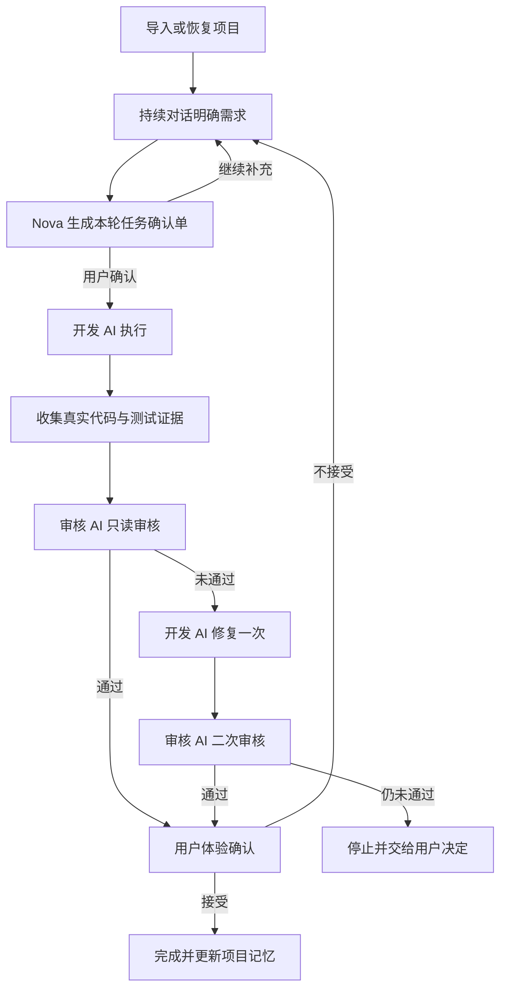

# Nova v0.1.0 最小 MVP 产品与开发文档 V2.0

**项目目录：** `D:\nova`  
**目标版本：** `v0.1.0-beta.1`  
**目标平台：** Windows 10/11 x64  
**默认角色：** Nova 项目经理 → Codex 开发 → Claude Code 独立审核  
**可选角色：** Nova 项目经理 → Claude Code 开发 → Codex 独立审核  
**主要用户：** 0 技术基础、0 代码经验的产品经理、小企业主、个体户和个人工作室  
**文档状态：** 根据 UI/UX 原型与用户最新反馈重新定义，替代旧版最小 MVP 的产品范围  

---

> **范围纠偏说明（2026-09-24，工作包 2）**
>
> 本文件第 5.1、5.3、10.1、16.1、18 节等处把"默认 Codex 开发、Claude Code 独立审核"的双 AI 强制闭环写成了 v0.1.0 的产品必需范围（P0）。这一表述已被范围纠偏替代：
>
> - **v0.1.0 产品主路径只要求用户选择并连接一个开发 AI**（Codex 或 Claude Code 二选一），Nova 自己独立验证真实文件、Git、测试、构建证据，支持真实效果预览和用户验收。
> - **强制第二 AI 独立审核、开发者与审核者必须不同、角色互换作为主路径能力、开发/首审/修复/复审四段强制闭环、`FIRST_REVIEW.md`/`SECOND_REVIEW.md` 必需化，均已明确推迟到 v0.2.0**，不是 v0.1.0 的启动或完成门禁。
> - "Nova 项目自身研发使用 Claude Code 开发、Codex 独立审核"是本仓库的工程协作方式，与 Nova 产品面向用户的功能无关，不得混淆为 v0.1.0 产品需求。
>
> 最新、唯一权威的范围说明见 `docs/release-v0.1.0/09_V0.1_SCOPE_CORRECTION09241121.md` 与 `docs/release-v0.1.0/CODEX_V0.1_SCOPE_CORRECTION_AUDIT_09211027.md`。本文件正文保留作为历史记录，不再代表当前生效范围。

---

## 1. 文档结论

Nova v0.1.0 的核心不再是“帮助用户新建一个项目”，而是：

> 帮助普通人从 GitHub 上找到或导入一个合适的开源产品，通过持续自然语言对话明确需求，由 Nova 像项目经理一样组织 Codex 和 Claude Code 完成开发、审核、修改、复审和用户验收，并把全部项目记忆长期保存在同一个项目中。

首版必须验证的核心价值是：

1. 用户不需要理解代码，也能从一个 GitHub 开源项目开始二次开发。
2. 用户不需要在 ChatGPT、Codex、Claude Code 三个窗口之间反复复制信息。
3. Nova 能持续理解同一个项目的目标、历史要求、决策和当前进度。
4. Nova 能把一次模糊想法通过多轮对话整理成可执行任务。
5. 一个 AI 负责开发，另一个 AI 独立审核，Nova 控制整个闭环并向用户解释结果。
6. 用户今天没有做完，明天重新打开 Nova，默认回到上次项目和上次未完成的位置。

---

## 2. 产品来源与核心痛点

Nova 来源于 SDKMAX / New API 二次开发的真实过程。在这个过程中，普通用户遇到的主要问题不是“不会写代码”，而是无法有效组织多个人工智能工具共同完成一个持续数周或数月的开发项目。

### 2.1 真实痛点

| 痛点 | 用户实际感受 | Nova 的解决方式 |
| --- | --- | --- |
| 不知道如何从 GitHub 开始 | 找到开源项目后，不知道是否适合、怎样下载、怎样修改 | 提供 GitHub 导入、项目说明和安全的启动指引 |
| 需求无法一次说清 | 一个功能往往要反复沟通几十次 | 提供项目级持续对话，允许不断补充、修正和追问 |
| 多个 AI 之间记忆混乱 | ChatGPT、Codex、Claude Code 各自只知道一部分 | Nova 维护统一项目记忆和结构化交接包 |
| 用户被迫承担项目经理工作 | 需要自己决定下一步、复制提示词、判断谁该工作 | Nova 自动组织需求、开发、审核、修复和验收门禁 |
| AI 回答与任务分类混乱 | 不知道某条内容属于产品要求、开发结果还是审核意见 | Nova 按项目、任务、决策、开发、审核、问题分类保存 |
| AI 可能只声称完成 | 普通用户无法判断代码是否真的可用 | Nova 汇总真实文件、Git、测试和独立审核证据 |
| 工作跨天后难以继续 | 重新打开工具后要再次解释背景 | 默认恢复上次项目、对话、任务和执行位置 |
| Codex 用量可能不足 | 开发中断后切换 Claude Code 要重新交接 | v0.2.0 增加提醒、冻结状态和一键接力 |

---

## 3. 产品定位

### 3.1 一句话定位

Nova 是面向普通人的 GitHub 开源产品二次开发助手，也是负责协调 AI 开发与审核的本地项目经理。

### 3.2 产品角色

Nova 在产品中承担原 SDKMAX 开发过程中 ChatGPT 的角色，但不是简单聊天机器人。Nova 必须履行以下项目经理职责：

- 理解用户最终想做成什么产品；
- 持续与用户对话，把模糊需求逐步说清楚；
- 区分“长期产品目标”和“本轮具体任务”；
- 汇总并维护项目背景、规则、约束、重要决策和历史问题；
- 判断信息是否足够开始开发；
- 生成用户能看懂的本轮任务确认单；
- 分配开发 AI 和审核 AI，并在任务开始后锁定角色；
- 控制开发、测试、审核、修复、复审和用户验收顺序；
- 阻止未通过审核的任务被标记为完成；
- 用普通语言解释风险、失败和下一步；
- 记录项目进度和真实统计；
- 在重新启动或更换 AI 后恢复完整上下文。

### 3.3 Nova 不是什么

Nova v0.1.0 不是：

- 通用 IDE 或代码编辑器；
- GitHub Desktop 替代品；
- 单纯的 AI 聊天客户端；
- 自动部署平台；
- 多人项目管理软件；
- 通用 Agent 平台；
- SDKMAX 模型商城或 API 客户端；
- 能把任何陌生仓库自动安装并运行的工具。

---

## 4. 目标用户

### 4.1 核心用户

- 有产品想法，但没有编程能力的创业者；
- 希望修改开源系统的小企业主和个体户；
- 能描述业务需求，但不理解代码和开发流程的产品经理；
- 已经在 ChatGPT、Codex、Claude Code 之间协作，但经常遭遇记忆与交接混乱的人。

### 4.2 用户不需要掌握

- 编程语言和软件架构；
- Git 分支、commit、diff、SHA；
- CLI、终端命令、退出码；
- 测试框架和构建工具；
- Codex 与 Claude Code 的提示词写法；
- 代码审核标准。

技术信息必须可核验，但默认放在“技术详情”中，不能成为用户完成主流程的前提。

---

## 5. 版本范围决策

### 5.1 v0.1.0 必须证明什么

首版只证明一条完整主路径：

> 导入一个符合范围的公开 GitHub 项目 → Nova 读懂项目 → 用户通过持续对话提出和补充要求 → Nova 形成任务确认单 → 开发 AI 修改 → 审核 AI 独立审核 → 开发 AI 修复 → 审核 AI 复审 → 用户确认 → 项目记忆和结果可在下次启动继续使用。

### 5.2 v0.1.0 支持的项目类型

首版只支持以下两类基础 MVP 项目：

1. **标准 Web 产品**：具有清晰 README、常见前端或全栈项目结构、可识别的依赖与本地运行说明。
2. **桌面客户端基础 MVP**：具有清晰 README，使用 Nova 首版明确支持的常见桌面技术栈，优先覆盖 Tauri + Web 前端类型项目。

首版不承诺支持：大型企业单体系统、复杂微服务、移动原生应用、游戏、嵌入式、区块链节点、来源不明或缺少基本说明的仓库。

项目类型识别失败时，Nova 必须说明“当前版本暂不适合处理这个项目”，不得假装支持。

### 5.3 功能优先级

| 优先级 | 功能 |
| --- | --- |
| P0 | GitHub 项目导入与安全分析 |
| P0 | 项目级长期记忆与默认恢复 |
| P0 | 持续需求对话与本轮任务确认 |
| P0 | Nova 项目经理编排 |
| P0 | Codex 开发、Claude Code 审核的完整闭环 |
| P0 | 角色互换 |
| P0 | 真实时间线、证据、失败恢复和用户验收 |
| P0 | 简单项目统计 |
| P0 | 中文与英文界面 |
| P1 | 打开电脑中已有的本地项目 |
| P1 | 从唯一内置模板新建空白产品 |
| v0.2.0 | Codex/Claude Code 用量提醒和一键接力 |

“新建产品”可以保留，但不得作为首页推荐入口，也不得抢占 GitHub 二次开发的核心定位。

---

## 6. 首页与项目入口

### 6.1 首页主次关系

首页第一主入口：

> **从 GitHub 开始改造产品**  
> 粘贴一个公开项目地址，Nova 帮你了解它并开始二次开发。

第二入口：

> **继续上次项目**  
> 仅当存在最近项目时显示，并作为再次启动 Nova 时的默认进入路径。

其他次要入口：

- 打开电脑中的项目；
- 新建基础产品（Beta）。

### 6.2 再次启动行为

- Nova 保存“最后活动项目”。
- 用户重新打开 Nova 时，默认进入最后活动项目，而不是回到空首页。
- 如果该项目有未完成任务，首先展示恢复卡：上次做到哪里、当前是否安全、下一步是什么。
- 用户可主动返回项目选择页并打开另一个目录。
- 切换项目不删除、不合并、不污染原项目记忆。
- 每个项目必须绑定唯一的本地目录和唯一的 Nova 项目标识。

---

## 7. 从 GitHub 开始

### 7.1 MVP 导入流程

1. 用户粘贴公开 GitHub 仓库地址。
2. Nova 校验地址是否合法且是否为公开仓库。
3. 用户选择一个新的空目录。
4. Nova 只执行 Clone，不自动执行仓库代码。
5. Nova 读取 README、许可证、安装文档、主要配置和目录结构。
6. Nova 判断项目属于：支持、可能支持但需确认、当前版本不支持。
7. Nova 用普通语言生成“项目说明卡”：
   - 这个产品是做什么的；
   - 适合修改成什么；
   - 当前主要功能；
   - 使用的技术类型；
   - 是否有许可证及其主要限制；
   - 本地运行还需要用户完成什么；
   - Nova 是否能在首版安全处理。
8. 用户确认“把它作为一个 Nova 项目”。
9. Nova 建立项目记忆与首个项目快照。

### 7.2 GitHub 安全边界

- 只支持公开仓库；
- 不保存 GitHub 账号密码；
- 不支持私有仓库认证；
- 不自动安装依赖；
- 不自动运行下载项目的脚本；
- 不自动 Push、不创建 PR；
- 目标目录非空时禁止覆盖；
- 缺少 README、许可证或安装说明时必须明确提示；
- Clone 失败、网络中断或项目过大时允许重试或安全退出。

“导入阶段不自动运行陌生代码”不等于项目永远不能测试。项目被用户确认、Nova 完成安全说明且用户按安装指南准备好本地环境后，开发任务可以运行项目已有且已识别的 lint、测试和构建命令；首次运行前必须向用户说明命令来源和用途。来源不明、带安装后脚本、需要管理员权限或可能修改系统环境的命令必须停止并让用户确认。

### 7.3 “找到项目”的 MVP 边界

v0.1.0 的核心是“导入用户已经选定的公开 GitHub 地址”，不开发完整的 GitHub 搜索引擎和开源项目推荐市场。界面可以提供如何复制 GitHub 地址的简单说明。

GitHub 搜索、分类推荐、项目评分和一键发现适合二次开发的项目进入后续版本。

---

## 8. 项目级持续对话与需求澄清

### 8.1 对话不是一次性表单

旧设计中“最多三组澄清问题”不符合真实使用过程，予以取消。

用户可以在项目对话中持续：

- 补充目标；
- 改变想法；
- 上传参考信息；
- 回答 Nova 的问题；
- 纠正 Nova 的理解；
- 把一个大需求逐步拆成多个小任务；
- 在数天后继续同一讨论。

Nova 不得因为对话轮数多而丢弃早期重要决策。

### 8.2 对话信息分类

Nova 自动把对话整理为以下结构，但普通用户不需要手工分类：

| 分类 | 内容 |
| --- | --- |
| 产品目标 | 最终想把项目做成什么 |
| 用户要求 | 用户明确提出的功能或体验要求 |
| 已确认决定 | 已被用户确认且后续必须遵守的决定 |
| 待确认问题 | 信息不足、冲突或需要选择的事项 |
| 本轮任务 | 当前准备交给开发 AI 的最小工作包 |
| 暂不处理 | 明确不在本轮或本版本实现的内容 |
| 开发结果 | 修改内容、测试和开发说明 |
| 审核意见 | Blocker、Major、Minor、Suggestion |
| 已知问题 | 未解决问题、限制和后续计划 |

### 8.3 开发前确认门禁

持续对话不等于边聊边无限修改代码。每次正式执行前，Nova 必须生成“本轮任务确认单”，用普通语言展示：

1. 你希望解决的问题；
2. 本轮会做什么；
3. 本轮不会做什么；
4. 怎样才算完成；
5. 可能影响哪些现有功能；
6. 开发者和审核者是谁；
7. 是否有用户尚未回答的关键问题。

只有用户点击“确认，开始这次工作”后，Nova 才能把结构化任务交给开发 AI。

如果用户在开发过程中补充的新要求会扩大范围，Nova 应保存该要求并提示：加入下一轮任务，或停止当前任务后重新确认。不得悄悄扩大正在执行的工作包。

---

## 9. 项目记忆系统

### 9.1 核心原则

> 记忆属于项目，不属于 Codex、Claude Code 或某一次聊天。

每个项目创建独立目录和独立记忆，不同项目之间不得串联需求、决策或代码上下文。

### 9.2 MVP 必须保存的项目记忆

- 项目名称、本地目录、GitHub 来源和许可证摘要；
- 项目用途和长期产品目标；
- 用户偏好和明确禁止事项；
- 已确认产品决策；
- 适用的 README、AGENTS、CLAUDE 等项目规则索引；
- 历史任务及其状态；
- 每轮需求确认单；
- 开发报告、测试结果、审核意见、修复和复审结果；
- 关键 Git 提交或安全快照；
- 当前未完成任务和恢复位置；
- 已知问题和版本 backlog；
- 最近活动时间和最后使用的角色配置。

### 9.3 上下文交接包

Nova 不把整个聊天记录原样塞给每个 AI。每次调用前根据角色生成结构化交接包：

**开发 AI 获得：** 项目目标、项目规则、本轮任务、验收标准、相关历史决定、允许修改范围、当前代码状态和待修复审核问题。

**审核 AI 获得：** 原始需求、验收标准、项目规则、Git diff、变更文件、真实测试证据和开发报告；不得把开发 AI 的“自我评价”当成通过依据。

**接力 AI 获得：** 已完成动作、未完成动作、当前文件状态、最近有效测试、风险、禁止重复执行的动作和下一步建议。

### 9.4 记忆冲突处理

发现新要求与旧决定冲突时，Nova 必须指出冲突并让用户选择，不得静默覆盖。用户确认新决定后，旧决定保留历史记录并标记为“已被替代”。

---

## 10. Nova 项目经理工作流



### 10.1 默认角色

- Nova：项目经理和唯一用户对话入口；
- Codex：默认开发与修复；
- Claude Code：默认只读审核与二次复审。

任务开始前允许一键互换为 Claude Code 开发、Codex 审核。任务开始后角色锁定；如需切换，必须先安全暂停并形成交接包。

### 10.2 审核门禁

审核问题等级：

- `Blocker`：任务不能继续或存在数据、安全、严重功能风险；
- `Major`：核心需求未完成或主要路径不可用；
- `Minor`：不影响核心路径，但应记录；
- `Suggestion`：优化建议，不阻断完成。

存在未关闭的 Blocker 或 Major 时，不得显示“已完成”。

MVP 只允许一次自动修复和一次复审。二次复审仍未通过时停止，交给用户决定下一轮，而不是无限消耗 AI 用量。

### 10.3 完工定义

只有三项同时满足才显示“项目任务已完成”：

1. **系统证据通过：** 真实文件、Git 状态、测试命令和退出结果可以核验；
2. **独立审核通过：** 审核 AI 给出 PASS 或允许上线的 PASS WITH NOTES；
3. **用户确认通过：** 用户实际体验并确认符合需要。

---

## 11. 页面与信息架构

### 11.1 视觉方向

保留当前原型的整体风格：干净、温和、克制、明确，接近 Codex 或 Claude Code 的低噪声体验，不使用赛博朋克、复杂终端界面或夸张动效。

### 11.2 调整后的主要页面

1. 首次启动与环境检查；
2. GitHub 导入首页；
3. GitHub 项目分析与确认；
4. 项目主界面；
5. 持续需求对话；
6. 本轮任务确认；
7. 开发—审核工作时间线；
8. 项目数据统计；
9. 失败、中断与恢复；
10. 完工确认与项目历史；
11. 次要入口：打开本地项目、新建基础产品。

### 11.3 项目主界面布局

推荐采用轻量三区结构，但不能做成 IDE：

- **左侧：** 当前项目、历史任务、新建任务、项目切换；
- **中部：** Nova 项目经理对话和当前任务的主要操作；
- **右侧可收起：** 项目概况、当前阶段、关键决定、真实证据和统计摘要。

普通用户默认只看到结论与下一步；代码差异、命令、退出码和原始日志在“技术详情”中展开。

### 11.4 每页体验规则

- 一个页面只突出一个主操作；
- 用户 5 秒内能知道：这是哪个项目、目前在做什么、下一步点哪里；
- 技术错误按“发生了什么—有没有影响—现在怎么做”解释；
- 状态不能只靠颜色；
- 未知进度不显示虚假百分比；
- 不展示模型私有思维链，只显示公开工作摘要和真实动作；
- 成功绿色只用于系统证据、独立审核和用户确认全部通过之后。

---

## 12. 项目数据统计

### 12.1 MVP 统计目标

项目统计的目的不是服务开发人员，而是让普通用户随时理解“项目进行了多久、完成了什么、还有什么问题”。

### 12.2 v0.1.0 统计项目

- 项目已进行天数；
- 总任务数；
- 已完成、进行中、等待确认和未通过任务数；
- 本周完成任务数；
- 累计开发与审核轮次；
- 审核一次通过、修改后通过、仍未通过的数量；
- 累计变更文件数；
- 最近一次真实测试结果；
- 当前未关闭 Blocker / Major / Minor 数量；
- 最近活动时间；
- 当前开发 AI 与审核 AI。

### 12.3 数据真实性

- 所有统计必须来自任务状态、Git、测试和审核记录；
- 不允许编造“完成百分比”；
- 不把 AI 自述当成统计证据；
- 数字可点击查看来源；
- 无数据时显示空状态，不显示 100% 或推测值；
- MVP 使用摘要卡和简单趋势，不开发复杂 BI 仪表盘。

---

## 13. 状态恢复

### 13.1 启动恢复

Nova 每次启动时读取：

- 最后活动项目；
- 上次所在页面；
- 当前任务状态；
- 最近成功完成的动作；
- 是否存在尚未结束的外部进程；
- 是否需要重新检查 Codex、Claude Code 或 Git 状态。

### 13.2 恢复原则

- 已完成动作不得重复执行；
- 收费或修改代码的动作必须具有唯一运行 ID；
- 无法判断动作是否完成时先暂停并询问用户，不能盲目重试；
- 恢复页用普通语言说明“上次做到哪里”和“继续后会发生什么”；
- 用户可以选择继续、查看详情或安全结束本轮任务。

---

## 14. 本地数据与建议结构

### 14.1 项目目录原则

一个项目对应一个用户选择的本地项目目录。Nova 的任务、文档和证据必须与该项目绑定，不得跨项目混用。

建议使用：

```text
<project>\
  .nova\
    project.json
    memory\
      PRODUCT_CONTEXT.md
      DECISIONS.md
      KNOWN_ISSUES.md
      BACKLOG.md
    tasks\
      <task-id>\
        REQUIREMENT.md
        DEVELOPMENT_REPORT.md
        TEST_REPORT.md
        FIRST_REVIEW.md
        FIX_REPORT.md
        SECOND_REVIEW.md
        FINAL_RESULT.md
```

实际数据库可使用本地 SQLite 保存索引、状态机、事件和统计；Markdown 保存可读项目记忆和每轮交付。SQLite 与 Markdown 必须建立稳定关联，避免出现两套互相冲突的事实。

### 14.2 隐私

- 数据默认保存在本机；
- v0.1.0 不需要注册 Nova 账号；
- 不默认上传项目源码、对话、提示词或日志；
- 日志、诊断包和报告必须脱敏；
- 用户主动导出诊断包前必须能预览内容。

---

## 15. 技术范围与架构要求

沿用仓库 Stage 0 已确认的真实技术栈；如果当前基线为 Tauri 2 + Vue 3 + TypeScript + Rust，则在该基础上开发，未经用户确认不得重写技术栈。

最小模块边界：

| 模块 | 责任 |
| --- | --- |
| Project Manager Core | 项目经理规则、下一步决策和门禁 |
| Project Registry | 项目目录、最近项目、最后活动项目 |
| Memory Store | 项目目标、决定、任务、问题和交接包 |
| Conversation | 持续对话、澄清、需求分类和任务确认 |
| Task State Machine | 开发、审核、修复、复审、验收状态 |
| AI Adapters | Codex 与 Claude Code 的独立适配器 |
| Process Runner | 超时、取消、退出码、日志分流和脱敏 |
| Git Evidence | 状态、差异、提交和可回滚证据 |
| GitHub Import | URL 校验、Clone、文档读取和安全限制 |
| Statistics | 从真实事件生成项目摘要数据 |
| i18n | 简体中文与英文用户文案 |

业务层不得在界面组件中直接拼接 Codex 或 Claude Code 命令。

---

## 16. v0.1.0 功能清单

### 16.1 P0 必须完成

- Windows 安装与首次启动；
- 中文/英文切换；
- Git、Codex、Claude Code 安装和登录状态检测；
- 粘贴公开 GitHub URL 并 Clone 到新目录；
- README、许可证、安装说明和项目类型分析；
- 支持范围判断与安全拒绝；
- 建立独立 Nova 项目；
- 默认打开最后活动项目；
- 项目级持续对话；
- 自动整理需求、决策、待确认问题和 backlog；
- 本轮任务确认单；
- 默认 Codex 开发、Claude Code 只读审核；
- 开始前角色互换；
- 开发、证据收集、首审、一次修复、复审、用户验收；
- 真实时间线；
- 中断、取消、失败和重启恢复；
- 七类任务文档；
- 项目记忆和 AI 交接包；
- 简单项目数据统计；
- 技术详情渐进展开；
- 本地数据与日志脱敏。

### 16.2 P1 可在不影响 P0 时完成

- 打开电脑中已有项目；
- 从唯一内置模板新建基础 Web 产品；
- 项目统计的简单趋势图；
- 项目历史的筛选和搜索。

### 16.3 v0.1.0 明确不做

- GitHub 项目搜索市场和智能推荐；
- 私有仓库授权；
- 自动安装和运行陌生项目；
- 自动 Push、PR、合并和部署；
- 多人协作和团队权限；
- 通用代码编辑器和终端；
- 无限自动修改；
- Codex/Claude Code 用量检测和自动切换；
- SDKMAX API、多模型商城或自动 Agent 路由；
- 云端项目记忆同步。

---

## 17. v0.2.0 第二版本必做方向

v0.2.0 的主题为：**AI 用量感知与无缝工作接力**。

### 17.1 目标

当 Codex 或 Claude Code 用量不足、达到提醒阈值、连接中断或暂时不可用时，Nova 帮助用户安全切换另一 AI，避免重新解释项目。

### 17.2 计划功能

- 显示 Codex 与 Claude Code 当前可获取的用量/状态信息；
- 在低于用户设置阈值时提醒，建议默认提醒阈值为剩余 20%；
- 无法可靠读取精确余量时，只显示“可能不足/无法获取”，不得伪造数字；
- 一键安全暂停当前 AI；
- 保存文件、Git、测试、任务状态和未完成动作；
- 自动生成结构化接力包；
- 用户确认后切换另一 AI 继续；
- 防止重复执行已完成步骤；
- 切换后仍由另一独立 AI 审核，不能让同一 AI 审核自己的工作；
- 切换历史进入项目时间线和统计。

### 17.3 后续路线

- v0.3.0：GitHub 项目发现、分类、评分和适配推荐；
- 后续版本：SDKMAX API 与多模型能力；
- 更后版本：基于成本、能力、可用性的自动模型或 Agent 路由。

---

## 18. 分阶段开发计划

最新执行分工：默认由 Claude Code 承担设计与主要开发，Codex 独立审核；但产品运行时默认角色仍为 Codex 开发、Claude Code 审核。不得把“开发本产品的团队分工”和“Nova 内部默认用户流程”混为一谈。

每个开发阶段执行：

> Claude Code 开发 → 本地测试 → 单一可回滚提交 → Codex 只读审核 → Claude Code 修复 → 本地复测 → Codex 复审 → 建立回滚点

### 阶段 0：重新冻结范围

- 用本文件对照现有 Stage 0 文档与 UI 原型；
- 标记因产品定位变化而失效的旧要求；
- 更新差距矩阵和实施地图；
- 不修改业务代码。

**门禁：** Codex 确认新范围无冲突、工作包可执行后再开发。

### 阶段 1：项目注册、记忆和恢复基础

- Project Registry；
- 最后活动项目；
- 项目级 SQLite 与 Markdown 索引；
- 状态机、运行 ID 和重启恢复；
- 项目隔离和记忆冲突规则。

**回滚点：** `milestone/project-memory`。

### 阶段 2：GitHub 核心入口

- 公开 URL 校验；
- Clone 到空目录；
- README、许可证和安装说明读取；
- Web/桌面 MVP 类型识别；
- 普通语言项目说明；
- 安全拒绝与异常处理。

**回滚点：** `milestone/github-entry`。

### 阶段 3：Nova 项目经理与持续对话

- 项目级对话；
- 需求、决定、冲突、待确认和 backlog 分类；
- 可持续多轮澄清；
- 本轮任务确认单；
- 范围变更控制；
- 开发/审核交接包。

**回滚点：** `milestone/project-manager`。

### 阶段 4：双 AI 开发审核闭环

- Codex/Claude Code 适配器；
- 默认角色和角色互换；
- 开发、真实测试证据、只读审核；
- 一次修复、二次审核；
- 用户验收；
- Blocker/Major 发布门禁。

**回滚点：** `milestone/dual-ai-loop`。

### 阶段 5：用户界面与项目统计

- 重新调整后的 GitHub 首页；
- 项目主界面和对话；
- 时间线、恢复和完工确认；
- 统计摘要；
- 技术详情渐进展开；
- 中英文、键盘、窗口与 125%/150% 缩放。

**回滚点：** `milestone/ui-statistics`。

### 阶段 6：本地项目与新建产品次要入口

- 打开已有项目；
- 唯一内置模板；
- 与项目记忆、对话和闭环共用相同流程。

**回滚点：** `milestone/secondary-entry`。

### 阶段 7：发布候选与 Windows 验证

- 完整本地端到端测试；
- GitHub Actions Windows 构建；
- 安装、启动、恢复、卸载测试；
- 发布文档、隐私、已知限制和回滚方案；
- Codex 最终独立审核。

---

## 19. 最小端到端验收场景

1. 新用户安装并完成中文首次启动。
2. 用户粘贴一个公开标准 Web 项目地址并成功导入。
3. Nova 用普通语言说明项目用途、许可证和运行准备。
4. 用户通过至少 10 轮连续对话逐步补充一个模糊需求，Nova 保留并正确整理所有已确认决定。
5. Nova 发现新旧要求冲突并要求用户选择。
6. Nova 生成本轮任务确认单，用户确认后才开始开发。
7. Codex 完成修改和测试，Claude Code 在只读状态审核。
8. 首审不通过后 Codex 修复，Claude Code 复审通过。
9. 用户不满意时创建下一轮任务，而不是篡改已完成记录。
10. 任务执行中关闭 Nova，重新打开后恢复到正确项目和阶段，不重复修改。
11. 切换到另一个项目后，两个项目的对话与决定不串联。
12. 项目统计能追溯到真实任务、Git、测试和审核记录。
13. GitHub 目录非空、无 README、无许可证、网络中断和不支持项目均有安全处理。
14. Claude Code 开发、Codex 审核的反向流程可以完成。
15. 技术小白不查看终端、diff 或 SHA 也能完成主流程并理解当前状态。

---

## 20. 测试与质量门禁

### 20.1 测试层级

| 层级 | 重点 |
| --- | --- |
| 单元测试 | 记忆分类、冲突检测、状态转换、运行 ID、统计计算、脱敏、i18n |
| 集成测试 | SQLite/Markdown、一致性、项目隔离、CLI 适配器、Git 证据、GitHub 导入 |
| 模拟端到端 | 成功、失败、取消、超时、恢复、首审不通过、二审失败、角色互换 |
| 真实 AI 冒烟 | 固定小型 Web 项目的开发—审核—修复—复审 |
| 用户测试 | 零技术用户完成 GitHub 导入、持续对话、任务确认、恢复和验收 |
| Windows 测试 | 安装、首次启动、路径含中文/空格、缩放、升级或回退、卸载 |
| 安全测试 | 命令注入、目录穿越、密钥脱敏、陌生仓库不执行、项目隔离 |

### 20.2 发布阻断条件

以下任意一项存在，禁止发布：

- 不同项目之间出现记忆、需求或文件串联；
- 多轮对话丢失已确认的重要决定；
- 未经用户确认即开始开发；
- 审核 AI 能写入项目文件；
- 存在 Blocker 或 Major 却显示完成；
- 恢复后重复执行修改或收费调用；
- GitHub 导入自动运行陌生脚本或覆盖非空目录；
- 用户已有修改被覆盖或丢失；
- 统计数字无法追溯到真实数据；
- 日志、数据库、报告或诊断包泄漏凭证；
- Windows 安装包无法在干净环境启动；
- P0 主路径存在无法退出、恢复或重试的死路。

---

## 21. 工作包完成定义

每个工作包只有同时满足以下条件才算完成：

1. 需求、范围和验收标准已有带时间戳的文档；
2. Claude Code 只修改约定范围；
3. 用户已有修改得到保护；
4. 新功能有自动测试或明确记录无法自动化的原因；
5. 本地检查通过并保存真实命令、退出码和结果；
6. Git diff 无无关改动和敏感信息；
7. 形成单一、可描述、可 `git revert` 的提交；
8. Codex 独立只读审核；
9. 无未处理 Blocker/Major；
10. Claude Code 完成有效修复并通过 Codex 复审；
11. 中英文文案、帮助和相关文档同步更新；
12. GitHub Actions 对相同提交通过。

---

## 22. 文档命名规则

Nova 项目所有新生成的普通 Markdown 文档使用：

`原文件名 + MMDDHHMM + .md`

示例：`NOVA_V0.1.0_MINIMUM_MVP_DEVELOPMENT_DOCUMENT_V209141918.md`。

- 时间使用北京时间（UTC+8）；
- 时间放在 `.md` 之前；
- 不覆盖旧版本；
- 实际引用使用完整文件名；
- `README.md`、`CHANGELOG.md`、`PRIVACY.md`、`AGENTS.md`、`CLAUDE.md` 等仓库固定文件按工程约定保留固定名称。

任务运行时生成的七类报告可以保留固定逻辑名称，但必须通过任务 ID、数据库版本和不可覆盖的历史记录保证追溯；如以普通文档形式另行导出，则添加时间戳。

---

## 23. 下一步执行顺序

1. 用户确认本开发文档的产品方向。
2. Claude Code 在 `D:\nova` 对照本文件、现有 UI 原型、Stage 0 审计和最终复审报告，生成“范围变更影响报告”，只更新设计和实施文档，不修改业务代码。
3. Codex 独立审核范围变更，重点检查 GitHub 主入口、持续对话、项目记忆、项目经理门禁、统计真实性及 v0.2.0 接力边界。
4. Claude Code 根据审核意见修正文档。
5. Codex 复审 PASS 后冻结 v0.1.0 V2 范围。
6. Claude Code 先修改 UI/UX 原型供用户确认。
7. 用户确认新原型后，再按照第 18 节逐阶段开发。
8. 每阶段均执行本地测试、Git 可回滚提交、Codex 独立审核和复审。

不得直接把整份文档一次性交给 Claude Code 全量开发。每次只执行一个阶段、一个可测试和可回滚的工作包。

---

## 24. 最终产品判断

Nova v0.1.0 的竞争力不在于“又一个可以调用 Codex 或 Claude Code 的界面”，而在于把普通人在真实二次开发中最费力的部分产品化：

- 从开源产品开始；
- 通过持续对话说清需求；
- 让 Nova 接管项目经理工作；
- 让两个 AI 分工而不混乱；
- 让项目记忆跨会话、跨工具保留；
- 让每次修改都有审核、证据和恢复能力；
- 让不懂代码的用户始终知道项目做到哪里、是否安全、下一步是什么。

只要首版稳定完成这一闭环，就已经具备清晰且可验证的产品价值。用量提醒与无缝 AI 接力应作为 v0.2.0 的核心升级，而不是挤入首版导致基础闭环失稳。
