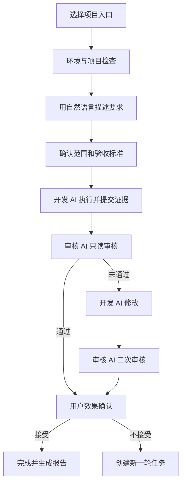

# Nova v0.1.0 最小上线版本指定开发计划

**项目目录：** `D:\nova`  
**目标版本：** `v0.1.0-beta.1`（首个公开测试版）  
**目标平台：** Windows 10/11 x64  
**开发与审核：** Codex 开发，Claude Code 独立审核  
**工程原则：** 本地先验证、Git 可回滚、GitHub 自动构建、上线后可运营  
**产品基线：** 《Nova V1 MVP 产品开发文档 V3.0》

---

## 1. 本次上线目标

首版只证明一件事：

> 非技术用户用自然语言提出一个开发要求，Nova 能协调 Codex 完成开发、Claude Code 独立审核、Codex 修改、Claude Code 二次审核，并用普通语言和真实证据告诉用户是否完工。

首个公开版本采用“小而完整”的策略：流程必须闭环、结果必须可信、出错必须可恢复；暂不扩大到自动部署、项目管理、额度接力或通用 Agent 平台。

### 1.1 上线成功标准

满足以下条件才能发布 `v0.1.0-beta.1`：

1. Windows 新用户能够安装并启动 Nova。
2. 无需注册 Nova 账号，任务数据默认保存在本机。
3. 能检测 Git、Codex CLI、Claude Code CLI 及其登录状态，并给出可理解的处理指引。
4. “新建产品（Beta）”“打开本地项目”“从 GitHub 导入”三个入口均可用。
5. 本地项目能够完成一次“需求确认—开发—首次审核—修改—二次审核—用户确认”闭环。
6. 默认 Codex 开发、Claude Code 审核，并支持一键互换角色。
7. 时间线持续显示真实的阶段、动作、等待、结果和错误，不展示模型私有思维链。
8. 每项任务生成完整 Markdown 文档和可核验的 Git、文件、测试证据。
9. Claude Code 审核期间默认只读，不允许修改项目文件。
10. 程序中断或关闭后能够恢复任务状态，不重复执行已经完成的步骤。
11. 中文和英文界面可切换，主要用户可见文案无遗漏。
12. 本地测试、GitHub Actions 构建及发布检查全部通过。

---

## 2. v0.1.0 严格范围

### 2.1 必须开发（P0）

| 模块 | 最小能力 | 本版限制 |
|---|---|---|
| 首次启动 | 语言选择、环境检测、结果解释 | 不代替用户安装或登录第三方 CLI |
| 新建产品 | 从唯一内置 Vue 3 + Vite + TypeScript 模板创建项目 | 不提供模板市场和复杂后台模板 |
| 本地项目 | 选择目录、检查 Git 和工作区状态、读取项目规则 | 不自动修复未知开发环境 |
| GitHub 导入 | Clone 公开仓库、读取 README/许可证、生成手动安装指南 | 不自动安装依赖，不自动运行仓库代码 |
| 需求确认 | 自然语言输入、最多三组澄清、范围和验收标准确认 | 不做通用产品规划系统 |
| 双 AI 闭环 | 开发、首次审核、一次修改、二次审核 | 不做无限自动循环 |
| 角色配置 | 默认 Codex 开发、Claude 审核；支持互换 | 每个任务启动后锁定角色，避免中途混乱 |
| 工作时间线 | 显示真实事件、当前动作、耗时、等待和错误 | 不展示原始思维链 |
| 证据与文档 | Git diff、改动文件、执行命令、测试结果、7类 Markdown 报告 | 不把 AI 自述当作验证证据 |
| 状态恢复 | 本地持久化、重新打开继续、失败后重试 | 不做多设备同步 |
| 双语 | 简体中文、英文 | 不做更多语言 |

### 2.2 明确不开发

- 自动部署线上环境、服务器、域名、Docker、Nginx、生产数据库。
- 自动安装或自动运行任意 GitHub 开源项目。
- GitHub 私有仓库授权、自动 Push、自动创建 PR。
- 项目管理、看板、团队权限和多人协作。
- Codex/Claude Code 用量检测与自动额度接力。
- SDKMAX 注册、充值、模型商城或 400 模型入口。
- 原始思维链展示、无限自动返工、自主扩大任务范围。

任何开发过程中出现的新增想法均进入 `docs/backlog.md`，不得直接加入 v0.1.0。

---

## 3. 核心用户流程



### 3.1 完工判断

Nova 只有在以下三类条件同时满足时，才显示“已完成”：

- **系统证据通过：** 文件真实存在、Git diff 可读取、规定命令真实运行且返回成功。
- **独立审核通过：** 审核 AI 根据需求、文档、代码差异和测试证据给出通过结论。
- **用户确认通过：** 用户确认结果符合实际需要。

否则显示“需要处理”“等待用户确认”或“未完成”，不能使用绿色完成状态。

---

## 4. 工程实施规则

### 4.1 角色边界

**Codex（开发者）负责：**

- 阅读产品基线、仓库规则和当前阶段任务。
- 编写或修改代码、测试和 Markdown 文档。
- 运行本地测试并提供原始命令、退出码和结果摘要。
- 每一阶段只处理约定范围，不顺手重构无关模块。
- 审核意见确认成立后修复，并形成修复报告。

**Claude Code（审核者）负责：**

- 独立阅读需求、验收标准、项目规则、相关 Markdown、Git diff 和测试结果。
- 在只读模式下复核代码、产品流程、异常路径、安全边界和测试真实性。
- 把问题按 `Blocker / Major / Minor / Suggestion` 分类，并给出文件位置、复现方法和通过条件。
- 不修改代码，不用自己的改动掩盖开发缺陷。
- 二次审核逐条核销首次审核问题，并给出 `PASS / PASS WITH NOTES / FAIL`。

### 4.2 禁止事项

- 不允许 Codex 自己审核并宣布上线。
- 不允许只凭“构建成功”判定功能完成。
- 不允许跳过本地测试直接依赖 GitHub Actions。
- 不允许在工作区有来源不明的未提交修改时开始批量开发。
- 不允许使用 `git reset --hard`、强制推送或覆盖用户修改作为常规回滚方式。
- 不允许把密钥、令牌、用户提示词、项目源码或完整日志提交到仓库。

---

## 5. Git 分支、提交与回滚方案

### 5.1 开始前先审计现有规则

Codex 必须先检查 `D:\nova` 当前分支、远程仓库、未提交修改、已有 CI、版本策略及 `AGENTS.md`/`CLAUDE.md` 等规则。若仓库已有分支规范，以现有规范为准；下述结构仅在没有既有规范时采用。

### 5.2 推荐分支结构

| 分支 | 用途 | 合并要求 |
|---|---|---|
| `main` | 可公开发布的稳定版本 | 只能接收通过发布门禁的 PR |
| `release/v0.1.0` | 发布候选修复与最终验证 | Claude 完整审核、全部 CI 通过 |
| `feature/v0.1.0-mvp` | v0.1.0 分阶段开发 | 每个工作包形成独立提交 |

不为了形式额外创建 `dev` 分支。当前仓库如果已经使用 `develop`、`dev` 或其他流程，则保持一致。

### 5.3 提交规则

- 一个提交只完成一个可描述、可测试、可回滚的工作包。
- 建议格式：`feat(scope): ...`、`fix(scope): ...`、`test(scope): ...`、`docs(scope): ...`。
- 每次提交前运行该阶段规定的快速测试。
- 每个阶段审核通过后打本地里程碑标签或记录提交 SHA。
- 合并前保存 `git status`、测试结果和 Claude 审核结论。

### 5.4 回滚等级

| 情况 | 处理方式 |
|---|---|
| 单个未合并提交有问题 | 新建 `git revert <sha>` 提交，保留历史 |
| 阶段性功能不稳定 | 回退该阶段 PR，恢复到上一个审核通过的 SHA |
| 新版本安装后严重故障 | GitHub Release 标记异常，恢复上一版下载入口并发布修复版 |
| SQLite 升级失败 | 升级前自动备份数据库；失败后恢复备份并保留错误日志 |
| 内置模板故障 | 恢复上一模板版本；模板带独立版本号并固定依赖版本 |

所有发布版本保留安装包、SHA256 和对应 Git tag。v0.1.0 不做自动更新，以避免首版更新链路增加风险。

---

## 6. 分阶段指定开发计划

每阶段严格执行：**Codex 开发 → 本地测试 → 提交 → Claude 只读审核 → Codex 修复 → 本地复测 → Claude 复审 → 建立回滚点**。

### 阶段 0：只读基线审计与范围冻结

**Codex 工作：**

1. 只读检查 `D:\nova`，不得修改代码、安装依赖或切换分支。
2. 识别技术栈、目录、现有功能、测试命令、构建方式、CI、未提交修改和潜在密钥。
3. 对照 V3 产品文档生成“已有/部分具备/缺失/冲突”差距矩阵。
4. 把后续开发拆成与本计划对应的工作包，并列出受影响文件。

**交付物：**

- `docs/release-v0.1.0/00_SCOPE09091050.md`
- `docs/release-v0.1.0/01_BASELINE_AUDIT09091050.md`
- `docs/release-v0.1.0/02_GAP_MATRIX09091050.md`
- `docs/release-v0.1.0/03_IMPLEMENTATION_MAP09091050.md`

**Claude 审核门禁：** 审计是否遗漏、范围是否越界、测试和构建命令是否来自真实仓库。审计通过前不进入编码。

### 阶段 1：运行骨架、环境检测和安全边界

**Codex 工作：**

- 确认或建立 Tauri 2 + Vue 3 + TypeScript + Rust 基础结构。
- 实现 Git、Codex CLI、Claude Code CLI 的路径、版本和可用性检测。
- 将检测结果翻译为用户可理解的“可用/需要登录/未安装/检测失败”。
- 建立统一进程执行器：超时、取消、退出码、stdout/stderr 分流、敏感信息脱敏。
- 定义开发适配器和审核适配器接口，业务层不得直接拼接 CLI 命令。

**本地测试：** 路径含空格/中文、CLI 缺失、未登录、非零退出、超时、用户取消、日志脱敏。

**Claude 门禁：** 命令注入、权限边界、密钥泄漏、进程残留和平台兼容性无 Blocker/Major。

**回滚点：** `milestone/runtime-foundation`。

### 阶段 2：任务状态机、本地存储和中断恢复

**Codex 工作：**

- 建立显式状态机：草稿、待确认、开发中、待审核、需修改、复审中、待用户确认、完成、失败、已取消。
- 使用 SQLite 保存项目、任务、阶段、事件、文档索引和证据索引。
- 每个外部动作具有唯一运行 ID，支持幂等恢复，避免重启后重复开发或重复审核。
- 数据库迁移前备份；失败后可恢复。

**本地测试：** 每一合法/非法状态转换、执行中强制退出、恢复、重复事件、数据库迁移失败、损坏数据提示。

**Claude 门禁：** 不存在绕过审核直接完成的路径；恢复不会重复执行破坏性动作。

**回滚点：** `milestone/task-engine`。

### 阶段 3：本地项目的双 AI 核心闭环

**Codex 工作：**

- 先只实现“打开电脑中的项目”，跑通主价值，暂不接另外两个入口。
- 实现需求输入、最多三组澄清问题、范围与验收标准确认。
- 生成开发、首次审核、修复、二次审核四类结构化提示词。
- 审核调用强制只读；开发与审核上下文分开，审核者必须独立判断。
- 实现一次自动修复与一次复审；仍未通过则停止并交给用户决定。
- 支持任务开始前互换 Codex/Claude 角色。

**任务文档目录：** `<项目>\.nova\tasks\<task-id>\`

**每项任务必须生成：**

- `REQUIREMENT.md`
- `DEVELOPMENT_REPORT.md`
- `TEST_REPORT.md`
- `FIRST_REVIEW.md`
- `FIX_REPORT.md`
- `SECOND_REVIEW.md`
- `FINAL_RESULT.md`

**本地测试：** 使用模拟 CLI 覆盖完整状态；再用一个无敏感数据的小型样例项目完成真实 Codex/Claude 冒烟测试。

**Claude 门禁：** 审核独立性、文档完整性、证据真实性、失败分支、角色互换均通过。

**回滚点：** `milestone/core-loop`。

### 阶段 4：时间线、证据中心和完工确认

**Codex 工作：**

- 用事件驱动时间线展示“正在检查项目”“正在修改文件”“正在运行测试”“等待审核”等真实状态。
- 每个事件显示时间、执行角色、状态、可展开摘要；长时间无事件时显示已运行时长和当前等待对象。
- 收集 Git 状态与 diff 摘要、变更文件、命令、退出码、测试结果和报告链接。
- 只展示可公开的工作摘要与工具活动，不要求或保存私有思维链。
- 完成页分别显示系统证据、审核结论、用户确认三项状态。

**本地测试：** 高频输出、超长输出、无输出长任务、取消、失败重试、应用重启后的时间线恢复。

**Claude 门禁：** UI 不伪造进度；失败不会显示为完成；日志无凭证与隐私泄露。

**回滚点：** `milestone/evidence-timeline`。

### 阶段 5：三个项目入口

**5A 新建产品（Beta）：**

- 只捆绑一个经过本地验证的 Vue 3 + Vite + TypeScript 模板。
- 用户确认名称、保存目录和产品简述后创建；目标目录非空时禁止覆盖。
- 初始化 Git，并记录模板版本。
- 超出模板能力的需求给出边界提示，不暗示可自动完成复杂后台。

**5B 打开本地项目：**

- 检查目录、Git、未提交修改、README、AGENTS/CLAUDE 等规则。
- 有未提交修改时明确提示，要求用户确认后再开始；不覆盖既有文件。

**5C 从 GitHub 导入：**

- 只接受合法公开 GitHub URL，Clone 到用户选择的新目录。
- 目标目录非空时禁止覆盖。
- 读取 README、许可证及主要安装文档，生成普通语言的手动安装调试指南。
- 安装命令只允许复制，不自动执行；README 缺失或 Clone 失败时给出明确下一步。

**本地测试：** 三个入口的成功、取消、目录冲突、网络失败、无 README、无许可证、无 Git、路径含中文和 GitHub 地址异常。

**Claude 门禁：** 陌生仓库代码绝不自动执行；文件覆盖、许可证提示和目录安全无重大问题。

**回滚点：** `milestone/project-entry`。

### 阶段 6：界面收敛和中英文

**Codex 工作：**

- 实现接近 Codex/Claude Code 的克制桌面风格：左侧项目与任务，中部工作区，右侧可收起证据/详情。
- 首页只突出三个项目入口；任务页突出当前状态和一个主要下一步操作。
- 技术错误先显示普通语言说明，再允许展开原始日志。
- 所有用户可见文案进入 i18n 资源；日期、时间、状态和错误均双语。
- 键盘操作、焦点、对比度、加载状态和空状态满足基础可访问性。

**本地测试：** 中英文切换、窗口缩放、125%/150% 系统缩放、长英文/中文、键盘导航、空状态、错误状态。

**Claude 门禁：** 非技术用户能够识别当前状态、风险和下一步；不得以“AI 已完成”代替证据。

**回滚点：** `milestone/ui-i18n`。

### 阶段 7：发布候选版、本地端到端验证

建立 `release/v0.1.0`，只允许修复发布阻断问题。

**必须执行的端到端场景：**

1. 全新安装后完成首次环境检测。
2. 新建模板项目并完成一次双 AI 闭环。
3. 打开已有 Git 项目，保留其未提交修改并完成任务。
4. 从公开 GitHub 仓库 Clone，生成手动安装指南，确认没有自动执行仓库脚本。
5. Codex 开发、Claude 审核完整流程。
6. Claude 开发、Codex 审核角色互换流程。
7. 首审不通过、修复、复审通过。
8. 复审仍不通过，正确停止并交给用户。
9. 执行中关闭应用，重启后恢复。
10. CLI 缺失、未登录、网络中断、命令失败、用户取消。

**验证环境：** 至少一台开发机和一套尽量接近干净 Windows 用户环境。真实 AI 冒烟测试控制在固定小项目和固定用例，其余使用模拟适配器，避免测试成本失控。

**发布材料：**

- `docs/release-v0.1.0/04_TEST_PLAN_AND_RESULTS.md`
- `docs/release-v0.1.0/05_CLAUDE_FINAL_REVIEW.md`
- `docs/release-v0.1.0/06_RELEASE_CHECKLIST.md`
- `docs/release-v0.1.0/07_ROLLBACK_PLAN.md`
- `docs/release-v0.1.0/08_KNOWN_LIMITATIONS.md`
- `CHANGELOG.md`
- `PRIVACY.md`

### 阶段 8：GitHub 构建、发布与上线运营

**Pull Request 构建门禁：**

- 前端格式检查、lint、TypeScript 类型检查和单元测试。
- Rust `fmt`、`clippy`、单元测试。
- 前端生产构建。
- Windows Tauri 安装包构建。
- 检查仓库是否误提交常见密钥和构建产物。

**Release 工作流：**

1. 合并经 Claude 最终审核的发布 PR 到 `main`。
2. 创建带注释标签 `v0.1.0-beta.1`。
3. GitHub Actions 在 Windows runner 重新构建，不上传本地手工打包文件。
4. 生成安装包、SHA256、版本说明和已知限制。
5. 若已有代码签名证书则使用 GitHub Secrets 签名；没有证书时必须在下载页明确说明 Windows 警告，不得伪造签名。
6. 将产物发布到 GitHub Releases，并保留上一版本下载入口。
7. 在另一台 Windows 环境下载发布产物，校验 SHA256，完成安装、启动、核心冒烟和卸载验证。
8. 验证通过后标记为公开 Beta；失败则撤回推荐入口并按回滚方案处理。

**首版运营最小配置：**

- GitHub README：一句话定位、演示图、安装方法、环境要求、隐私说明和限制。
- Issue 模板：Bug、功能建议、安装问题；要求用户先脱敏日志。
- 发布说明：新增功能、已知限制、升级/回退方法和支持入口。
- 本地“导出诊断包”：默认去除密钥、用户内容和项目源码，由用户预览后主动导出。
- 不默认上传遥测、提示词、源码或日志。崩溃统计和匿名使用分析延后，未来加入时必须明确告知并允许退出。

**回滚点：** Git tag `v0.1.0-beta.1`，同时保留上一稳定发布（首版发布前则保留审核通过的 RC 安装包）。

---

## 7. 测试矩阵

| 层级 | 重点 | 执行时机 |
|---|---|---|
| 单元测试 | 状态转换、事件解析、脱敏、提示词结构、i18n、路径校验 | 每次相关提交 |
| 集成测试 | SQLite、进程执行器、CLI 适配器、Git 证据、文档生成 | 每个阶段结束 |
| 模拟端到端 | 成功、失败、取消、超时、恢复、审核不通过 | 每个 PR |
| 真实 AI 冒烟 | 固定样例项目的开发—审核—修复—复审 | 核心闭环、RC 和正式发布前 |
| Windows 安装测试 | 安装、首次启动、升级/回退、卸载 | 每个 Release Candidate |
| 安全测试 | 命令注入、目录穿越、密钥脱敏、陌生仓库不执行 | 基础层、GitHub 入口、RC |

测试报告必须记录操作系统、应用版本、Git SHA、命令、退出码、通过/失败数量和失败原因。截图或 AI 文字描述只能作为补充，不能替代机器结果。

---

## 8. 发布阻断清单

以下任意一项存在即禁止上线：

- 无法稳定完成默认双 AI 闭环。
- 审核 AI 能够意外写入项目。
- 测试未运行却显示通过，或任务未通过却显示完成。
- GitHub 导入会自动执行项目脚本或覆盖非空目录。
- 中断恢复会重复修改文件或重复触发收费调用。
- 日志、数据库、诊断包或 Git 仓库泄漏令牌和凭证。
- 用户既有未提交修改被覆盖或丢失。
- Windows 安装包不能在干净环境启动。
- GitHub Actions 产物与已审核 Git tag 不一致。
- P0 用户路径存在死路，错误后无法退出、重试或保存信息。
- `Blocker` 或 `Major` 级 Claude 审核问题未关闭。

`Minor` 可以带已知限制上线，但必须登记责任、影响和后续版本；`Suggestion` 不阻断发布。

---

## 9. 完成定义（Definition of Done）

一个工作包只有同时满足下列条件才算完成：

1. 需求和验收标准已写入文档。
2. Codex 只修改约定范围内的文件。
3. 新功能有自动测试或明确说明无法自动化的原因。
4. 本地规定检查全部通过并保存结果。
5. Git diff 已人工/AI 检查，无无关改动和敏感信息。
6. 形成单一、清晰、可回滚的 Git 提交。
7. Claude Code 独立审核，无未处理 Blocker/Major。
8. Codex 完成有效问题修复，Claude Code 二次确认。
9. 对用户可见的变化同时更新中英文、帮助和必要文档。
10. 对应 GitHub Actions 通过。

---

## 10. 第一个工作日的执行顺序

不要让 Codex 直接开发整份计划。正确启动顺序如下：

1. 将本计划和 V3 产品文档放入 `D:\nova\docs\product\`。
2. 在 `D:\nova` 打开 Codex，只执行下方“阶段 0 审计提示词”。
3. 阅读审计报告，确认当前仓库是否已有可复用代码，以及真实测试/构建命令。
4. 在同一目录打开 Claude Code，只执行“阶段 0 审核提示词”，保持只读。
5. Codex 根据审核意见修正文档，不修改产品代码。
6. Claude 复审通过后，冻结 v0.1.0 范围并建立首个基线提交。
7. 再逐阶段发送本计划中对应的开发任务；每次只发送一个阶段。

如果阶段 0 发现现有项目技术栈与 V3 建议不同，不应立即重写。先比较“沿用现有技术栈”和“迁移”的成本、风险及可测试性，再由用户确认。

---

## 11. 可直接交给 Codex 的阶段 0 提示词

```text
你是 Nova 项目的开发负责人。项目目录是 D:\nova。

本轮只做“v0.1.0 阶段 0：只读基线审计与范围冻结”，禁止开始开发产品功能。

请先阅读：
1. 仓库内全部适用的 AGENTS.md、CLAUDE.md、README 和贡献规则；
2. docs/product/ 下的《Nova V1 MVP 产品开发文档 V3.0》；
3. docs/product/ 下的《Nova v0.1.0 最小上线版本指定开发计划》；
4. 现有 package、Tauri、Rust、测试、构建和 GitHub Actions 配置。

安全限制：
- 只读检查代码和 Git 状态；不要安装依赖、运行来源不明的脚本、修改代码、切换分支、提交、推送或删除文件。
- 不得使用 git reset --hard、clean、checkout 覆盖文件等破坏性命令。
- 先报告当前分支、remote、git status 和用户已有修改；这些修改不得被覆盖。
- 输出中隐藏密钥、令牌和个人信息。

请产出以下文档草案：
- docs/release-v0.1.0/00_SCOPE09091050.md
- docs/release-v0.1.0/01_BASELINE_AUDIT09091050.md
- docs/release-v0.1.0/02_GAP_MATRIX09091050.md
- docs/release-v0.1.0/03_IMPLEMENTATION_MAP09091050.md

内容必须包括：
- 当前真实技术栈、目录结构、已经实现的功能；
- 测试、lint、类型检查、构建、Tauri 打包的真实命令及命令来源；
- 现有 CI、分支、版本和发布方式；
- 对照 v0.1.0 P0 的“已有/部分具备/缺失/冲突”矩阵；
- 每个阶段预计修改的模块和文件，但不要写代码；
- 风险、未知项、阻断项和需要用户决定的问题；
- 建议的最小提交与回滚点；
- 明确列出 v0.1.0 不做内容，防止范围扩大。

本轮结束时，只汇报审计结论、生成的文档、尚未确认事项，以及建议交给 Claude Code 重点审核的风险。不要声称已经开始或完成开发。
```

> 注：严格只读与“生成文档”存在操作层面的冲突。执行时允许 Codex 只新建上述四份审计文档，但不得修改应用代码、配置、锁文件或现有文档；如果希望绝对只读，则先把报告输出到对话，确认后再保存。

---

## 12. 可直接交给 Claude Code 的阶段 0 审核提示词

```text
你是 Nova v0.1.0 的独立审核负责人。项目目录是 D:\nova。

本轮只审核 Codex 的阶段 0 基线审计，不开发、不修复、不修改任何文件。请使用只读方式工作。

请阅读：
- 仓库规则、README、构建和测试配置；
- docs/product/ 下两份产品与开发计划；
- docs/release-v0.1.0/00_SCOPE09091050.md；
- 01_BASELINE_AUDIT09091050.md；
- 02_GAP_MATRIX09091050.md；
- 03_IMPLEMENTATION_MAP09091050.md；
- 当前 git status 和必要的源代码/配置。

请独立验证：
1. Codex 描述的技术栈、已有功能和缺失项是否与仓库一致；
2. 测试、构建和打包命令是否来自真实配置，而不是推测；
3. 是否遗漏用户已有修改、敏感信息、Windows/Tauri 风险；
4. 工作包是否严格符合 v0.1.0 范围，是否混入自动部署、项目管理、额度接力等非目标；
5. Codex/Claude 的开发与只读审核边界是否可实现；
6. Git、SQLite、任务恢复、CLI 子进程和 GitHub 导入的回滚/安全方案是否充分；
7. 验收标准是否可实际执行并形成证据。

按 Blocker、Major、Minor、Suggestion 列出问题。每项必须包含：依据、文件或配置位置、影响、建议修正和复审通过条件。

最后给出唯一结论：
- PASS：可以进入阶段 1；
- PASS WITH NOTES：没有阻断问题，可进入阶段 1，但要登记非阻断项；
- FAIL：不得进入阶段 1。

不得修改代码或替 Codex 修复问题。
```

---

## 13. 最终发布决策

最终是否上线由用户决定，但上线建议必须同时具备：

- Codex 提交的发布候选版本和完整开发/测试文档；
- Claude Code 对发布分支和最终 Git diff 的独立 `PASS`；
- 本地端到端测试通过；
- GitHub Actions 对对应 tag 构建通过；
- 从 GitHub Release 下载的安装包在另一 Windows 环境通过冒烟测试；
- 已知限制、隐私说明和回滚方法对用户公开。

没有这些证据时，版本只能标记为内部测试，不应对外投放广告。

